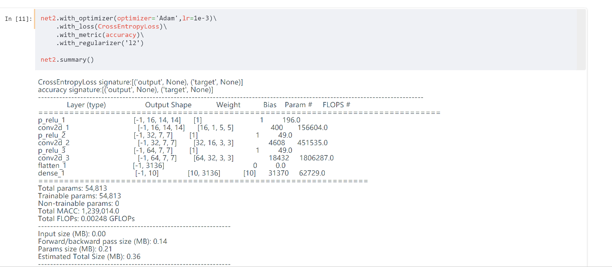

# 如何建構圖像識別模型AB Test

## 場景

幾乎所有深度學習的hello world就是mnist手寫數據集，我們在這也不例外，我們將會透過這個案例的實作來讓大家理解trident的主要特性與使用邏輯。

## 需求

基於mnist手寫數據集，建構一個識別10個數字的分類模型。但是我們想要知道到底使用傳統的relu活化函數，還是使用參數化relu (parametered relu)哪個效果好一點。這時候我們會需要一個AB Test來協助我們比較兩者的效果。

## 代碼

```python
import os
os.environ['TRIDENT_BACKEND'] = 'pytorch'
import trident as T
from trident import *

data_provider = T.load_mnist('mnist')  
data_provider.image_transform_funcs = [add_noise(0.1),normalize(127.5, 127.5)]  

def convnet(activation='relu'):
    return Sequential(
        Conv2d((5,5),16,strides=2,auto_pad=True,activation=activation),
        Conv2d((3, 3),32, strides=2, auto_pad=True,activation=activation),
        Conv2d((3, 3), 64, strides=1, auto_pad=True,activation=activation),
        Flatten(),
        Dense(10)
    )

net1=Model(input_shape=(1,28,28),output=convnet('relu'))
net2=Model(input_shape=(1,28,28),output=convnet('p_relu'))
net1.summary()
net2.summary()


net1.with_optimizer(optimizer='Adam',lr=1e-3) \
    .with_loss(CrossEntropyLoss)\
    .with_metric(accuracy)\
    .with_regularizer('l2')\


net2.with_optimizer(optimizer='Adam',lr=1e-3)\
    .with_loss(CrossEntropyLoss)\
    .with_metric(accuracy)\
    .with_regularizer('l2')


plan=TrainingPlan()\
    .add_training_item(net1,name='net1')\
    .add_training_item(net2,name='net2')\
    .with_data_loader(data_provider)\
    .repeat_epochs(10)\
    .within_minibatch_size(64)\
    .print_progress_scheduling(10,unit='batch')\
    .display_loss_metric_curve_scheduling(100,unit='batch',imshow=True)

plan.start_now()
```


設定 `with_loss()` 時，各後端的類別軸、權重與 reduction 可查閱[跨後端 loss 定義](losses.md)。

## 設定 learning rate warmup

在設定 optimizer 後、呼叫 `plan.start_now()` 前，可以替每個模型分別設定暖身。例如，讓第一組模型先暖身 500 次參數更新，再進入 cosine 排程，第二組則在暖身後維持固定 LR。

```python
from trident.callbacks import CosineLR, LinearWarmup

warmup = LinearWarmup(steps=500, start_factor=0.01)
net1.with_learning_rate_scheduler(CosineLR(period=2000), warmup=warmup)
net2.with_learning_rate_scheduler(warmup=warmup)
```

第一次更新使用各參數群組基準 LR 的 1%，第 500 次更新達到 100%。可依希望 LR 如何變化選擇暖身方式。

| 希望的更新方式 | 暖身設定 | 前五次更新的基準 LR 倍率（約） |
|---|---|---|
| 每次增加相同的量 | `LinearWarmup(5, .01)` | .01、.258、.505、.753、1 |
| 起步與收尾平緩，中段增幅最大 | `CosineWarmup(5, .01)` | .01、.155、.505、.855、1 |
| 從很小的 LR 按固定倍數放大 | `ExponentialWarmup(5, .01)` | .01、.032、.1、.316、1 |
| 先用固定低 LR 訓練，再切換到主排程 | `ConstantWarmup(5, .01)` | .01、.01、.01、.01、.01 |

前三種曲線在最後一次暖身更新達到基準 LR，因此 `steps=1` 時直接使用基準 LR。固定暖身會用指定倍率完成全部更新，下一次才交給主排程。指數暖身需要大於零的 `start_factor`。

知道訓練預計會執行幾次 optimizer 更新時，也可以用比例設定長度。以下設定把 12,000 次更新的前 3%（360 次）分配給暖身。四種曲線都支援 `from_ratio()`。比例範圍為 `0 < ratio <= 1`，遇到不足一步時向上取整。

```python
from trident.callbacks import CosineWarmup

warmup = CosineWarmup.from_ratio(0.03, total_updates=12_000, start_factor=0.01)
net1.with_learning_rate_scheduler(CosineLR(period=2000), warmup=warmup)
```

這組設定也可簡寫為 `net1.with_learning_rate_scheduler(CosineLR(period=2000), warmup="cosine")`。從 INI 讀取 `warmup="cosine"` 時，可將讀到的值直接傳給同一個參數。此簡寫固定使用 360 次成功更新，從各參數群組基準 LR 的 1% 升至 100%。若要依其他訓練預算計算暖身長度，使用上面的 `from_ratio()` 傳入自己的 `total_updates`。

`total_updates` 填入該 optimizer 的預計更新次數。梯度累積完成一次才計一步，AMP overflow 跳過的更新不計步。串流資料或更新總數未知時，可直接指定 `steps`。整數寫法 `warmup=5` 的單位仍是 epoch。

使用外部暖身時，請將 AdamW 或 Ranger21 的內建 warmup 關閉。若在設定後才新增參數群組，trainer 會在下一次 optimizer 更新前檢查新群組的暖身設定。

`CausalLanguageModel` 接受相同的 `warmup`，主排程沿用 PyTorch 原生 scheduler。語言模型的訓練 checkpoint 會自動保存進度。一般模型的 `save_model()` 用於儲存模型權重。自訂訓練 checkpoint 時，請一併保存 `model.optimizer.state_dict()` 和 `model.lr_scheduler.state_dict()`，並依相同順序載回。

原生 PyTorch 語言模型的分片載入、模組權重選取、分層推論與低顯存微調範例，請見[低記憶體模型設定](low-memory.md)。

## 成果

```python
import os
os.environ['TRIDENT_BACKEND'] = 'pytorch'
import trident as T
from trident import *
```

```python

data_provider = T.load_mnist('mnist')  
data_provider.image_transform_funcs = [add_noise(0.1),normalize(127.5, 127.5)]  
```


```python
def convnet(activation='relu'):
    return Sequential(
        Conv2d((5,5),16,strides=2,auto_pad=True,activation=activation),
        Conv2d((3, 3),32, strides=2, auto_pad=True,activation=activation),
        Conv2d((3, 3), 64, strides=1, auto_pad=True,activation=activation),
        Flatten(),
        Dense(10)
    )

net1=Model(input_shape=(1,28,28),output=convnet('relu'))
net2=Model(input_shape=(1,28,28),output=convnet('p_relu'))
net1.summary()
net2.summary()
```



```

net1.with_optimizer(optimizer='Adam',lr=1e-3) \
    .with_loss(CrossEntropyLoss)\
    .with_metric(accuracy)\
    .with_regularizer('l2')\
```


```python

plan=TrainingPlan()\
    .add_training_item(net1,name='net1')\
    .add_training_item(net2,name='net2')\
    .with_data_loader(data_provider)\
    .repeat_epochs(10)\
    .within_minibatch_size(64)\
    .print_progress_scheduling(10,unit='batch')\
    .display_loss_metric_curve_scheduling(100,unit='batch',imshow=True)

plan.start_now()
```


## 多輸入、多輸出的欄位對應

PyTorch 與 TensorFlow trainer 共用平坦的欄位名稱。模型的具名輸出可由多個 loss 或 metric 共用。以下模型的 `forward(front, side)` 回傳含 `color_logits` 和 `size_logits` 的字典，資料集另提供兩組標籤。

```python
from trident import loss, metric

model.data_feed = {"front": "front_image", "side": "side_image"}

@loss
def garment_loss(color_logits, color_id, size_logits, size_id):
    return color_criterion(color_logits, color_id) + size_criterion(size_logits, size_id)

@metric(input_names={"pred": "size_logits", "truth": "size_id"})
def head_accuracy(pred, truth):
    return accuracy(pred, truth)

model.with_loss(garment_loss, as_metric=True)
model.with_metric(head_accuracy, name="size_accuracy")
model.with_metric(head_accuracy, name="color_accuracy",
                  input_names={"pred": "color_logits", "truth": "color_id"})
```

範例中的 `color_criterion`、`size_criterion` 和 `accuracy` 是使用者選定的損失與指標函式。字典左側為函式參數，右側為實際欄位。單次註冊可覆寫裝飾器的對應，其次採用 trainer 的 `data_feed`。同名欄位可直接使用；常見的 `output`、`target` 也可使用角色與形狀相容的唯一候選。若有兩個候選，例外會列出欄位名稱與指定方式。

函式可用 Trident 的 `TensorSpec` 實例註解參數，例如 `pred: TensorSpec(shape=TensorShape([None, 3]))`。這表示第二維固定為 3，batch 大小可變。`as_metric=True` 會把這次運算的原始 loss 數值脫離梯度後寫入指標紀錄；`loss_weight` 僅影響訓練用的加權損失。

## 使用 GanTrainingPlan 訓練 GAN

啟動 Python 前，將 `TRIDENT_BACKEND` 設為 `pytorch`、`tensorflow` 或 `jax`。PyTorch 和 TensorFlow 使用各自的 Trident `Model`。以下範例使用提供 `real` 和 `latent` 欄位的資料批次。

```python
from trident.optims.trainers import GanTrainingPlan

plan = (GanTrainingPlan(seed=42)
        .with_discriminator(discriminator)
        .with_generator(generator)
        .with_batch_fields(real='real', generator_input='latent')
        .with_gan_type('wgan-gp')
        .with_data_loader(provider)
        .with_batch_size(32)
        .repeat_epochs(10))
plan.start_now()
```

加入模型的先後決定每批的更新順序。成對資料可用 `condition` 指定條件欄位，雙輸入判別器依序接收樣本和條件。`wgan-gp` 預設使用權重 10 的梯度懲罰，可用 `with_gradient_penalty()` 調整。Wasserstein critic 應輸出無界分數，且每個樣本的分數應獨立於批內其他樣本。`gan` 和 `dcgan` 可以用 `from_logits=False` 搭配輸出機率的判別器。

### 其他對抗目標

以下種類可直接傳入 `with_gan_type()`。判別器輸出未經 sigmoid 的分數。

| 設定 | 目標 |
| --- | --- |
| `hinge` | 判別器使用單位間隔的 hinge loss，生成器提高生成樣本的分數 |
| `rsgan` | 對同一批內逐筆配對的真實與生成分數差使用 logistic loss，兩邊輸出形狀須相同 |
| `ralsgan` | 將各樣本分數與另一組的批次平均比較，再使用平方損失 |
| `rahinge` | 對相對於另一組批次平均的分數使用 hinge loss |
| `gan-r1` | 非飽和 logistic GAN，每次判別器更新在真實樣本上加入 R1 梯度正則化 |

`gan-r1` 預設 `r1_gamma=10`。用 `with_gan_type('gan-r1', r1_gamma=5)` 可調整強度。R1 使用真實樣本分數對輸入的梯度範數平方，逐樣本計算後平均，再乘上 `r1_gamma / 2`。判別器的逐樣本分數應彼此獨立。[Hinge 與相對式目標](https://arxiv.org/html/1807.00734) · [R1 正則化](https://arxiv.org/abs/1801.04406)

### JAX 模型

JAX 使用函數式模型。以下兩個 `apply` 函式接收參數 PyTree 和輸入，訓練後可從 `generator.params` 取得更新權重。

```python
from trident.optims.trainers import JaxGanModel

generator = JaxGanModel(generator_apply, generator_params)
discriminator = JaxGanModel(discriminator_apply, discriminator_params)
```

兩個模型預設各自使用 Adam，並將梯度全域範數裁剪到 10。PyTorch 和 TensorFlow 可用模型既有的 `with_grad_clipping()` 和 `with_accumulate_grads()` 調整。JAX 也接受 `with_grad_clipping()`，並可在建立時傳入 Optax 相容的 `optimizer`。JAX 模型的 `apply` 使用純函式，功能範圍為無可變模型狀態的前向運算。
